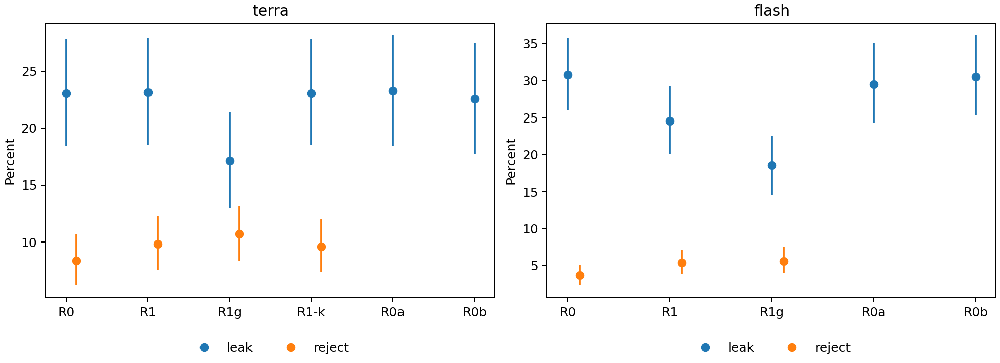

# 语义审核何时值得信任：提示规则、重复审核、第二意见与一次标签复核

**评估报告 v0.4 · 2026年11月10日 · Shuo Deng（邓硕）**

本版纳入74道标签分歧题的技术复核，以及在复核标签上的重算（核查材料对应提交 `5b7a424`）。文中标“发布标签”的数字按采集前冻结的方法计算，标“复核情景”的数字来自事后的标签敏感性分析。

## 1. 概要

把数学题翻译成 Lean 命题时，编译通过只保证命题合乎语法和类型，不保证它说的就是原题。数据集里有一道题问 1、3、5、7、9、11 之积的个位数，形式命题写成

```lean
(∏ k in Finset.range 6, 2 * k + 1) % 10 = 5
```

逐项看都对得上。可是 Lean 的求积记号在加号之前就结束了，这个式子实际是 `((∏ k in Finset.range 6, 2 * k) + 1) % 10 = 5`；k=0 使乘积为0，整个命题可以被证明为假。本次聚焦的6道绑定错误题，两个审核模型一共做了150次判断，接受了148次。

检查“形式命题是否表达原题”的环节叫语义审核，现在通常交给语言模型。本实验用858个带人工标签的题目—命题对作外部参照，测量这个环节在三件事上的表现：详细的审核规则是否比一句话提示更好；同一审核重复几遍能多拦下多少错误；换一个模型做第二意见又能补上多少。两个模型共完成19,170次正式判断。之后，74道模型与标签高度冲突的题做了逐题技术复核（由 Codex 执行，分工见5.1节），全部结果在修订后的标签上重算。

主要发现有四项。

**规则的收益取决于模型。** 按发布标签，Terra 用六条审核规则（R1）和用一句话提示（R0）的漏放率是23.15%和23.03%，规则没有减少漏放，还多拒了1.46个百分点的忠实题。DeepSeek 用同一套规则，漏放率从30.79%降到24.54%。数据集来源论文所用的审核提示（R1g）在两个模型上都比 R1 再少漏约6个百分点，误拒增加不到1个百分点。

**重复和第二意见买到的改善有限，因为错误稳定而且重合。** 同一模型把一道题审三遍，结论很少变化；R1 下 Terra 有59道、DeepSeek 有54道不忠实标签题三次都被接受。两个模型各审一次、都接受才放行，仍然共同漏掉55题。Terra 只审一次但把提示换成 R1g，漏47题，比用 R1 审三遍且三次都接受才放行（漏59题）还少12题，误拒数相同。

**模型和标签稳定冲突时，错的可能是任何一方。** 有26道不忠实标签题在全部25次判断中都被接受。74道高冲突题的复核结果是：37题的形式命题可以接受，23题确实不忠实，14题取决于翻译约定或原书上下文。相对发布标签，33题由不忠实改为忠实，15题由忠实改为不忠实。那26道题里，18道可接受，5道是开头那种绑定错误，3道属于约定差异。

**换用复核标签后，错误率的水平下降，选择结论和主要取舍保持不变。** 替换48个标签后，各配置的漏放率下降8到11个百分点。冻结的选择规则仍给出同样的结论：Terra 用 R0 替换 R1，DeepSeek 用 R1g 替换 R1。这条规则只回答“R1 能否被替换”，没有在 R0 和 R1g 之间直接择优，Terra 的情况见3.2节。

**表1｜两种标签下的漏放率和误拒率（点估计）**

| 模型 | 提示 | 漏放率 · 发布标签 | 漏放率 · 复核情景 | 误拒率 · 发布标签 | 误拒率 · 复核情景 |
|---|---|---:|---:|---:|---:|
| Terra | R0 | 23.03% | 12.35% | 8.36% | 5.56% |
| Terra | R1 | 23.15% | 12.84% | 9.82% | 7.14% |
| Terra | R1g | 17.13% | 6.79% | 10.70% | 8.16% |
| DeepSeek | R0 | 30.79% | 22.47% | 3.68% | 1.87% |
| DeepSeek | R1 | 24.54% | 15.31% | 5.38% | 3.29% |
| DeepSeek | R1g | 18.52% | 10.37% | 5.61% | 4.20% |

发布标签：不忠实288题、忠实570题。复核情景：不忠实270题、忠实588题。模型输出完全相同，只有标签不同。

两套数字的地位不一样。发布标签下的结果按采集前冻结的方法得出。复核情景是事后的敏感性分析：复核由 Codex 执行，选题依据模型分歧，没有独立人工盲审。它不是金标准，两套数字也不构成真实错误率的上下界。

## 2. 问题与设计

### 2.1 问题从哪里来

本实验与[概率论形式化工程](https://github.com/Kind-NK-Hill/ProbabilityTheoryFormalization)、[智能体工作流评估](https://github.com/Kind-NK-Hill/review-history-evaluation)是三个独立项目。形式化工程提出了审核是否可靠的问题；工作流评估研究协作配置、证明完成和交接失败；本实验把形式化工程审核标准中关于命题忠实性的部分改编成提示 R1，放到一个有人工标签的外部数据集上检验。

它检验的是这一个组件。原工程的证明主线、依赖和交付验收不在其中，所以这里的结果既不重新证明旧工作流的优劣，也不解释旧模型当年为何失败。

要回答的问题有三个：哪些审核指令值得保留；同一审核多做几次能减少多少漏放；换一个模型提供第二意见时，剩下的漏放是否仍然重合。

### 2.2 任务、数据和模型

每次判断给模型三样东西：自然语言题面、Lean 头部和形式命题，证明部分省略。模型返回一个 JSON，含判断词 `verdict`（忠实、不忠实或不确定）和一句理由 `reason`。

数据来自固定版本的 [ConsistencyCheck](https://huggingface.co/datasets/GuoxinChen/ConsistencyCheck/tree/1c6a6cca0f87b48d4cccb49946d3b8fc57a1eef9)，即 [ReForm 论文](https://arxiv.org/html/2510.24592v3)发布的人工标注集；按论文附录 B，每题由两位专家独立标注、第三位裁决。859行去重后是858个唯一输入，发布标签为忠实570题、不忠实288题。其中 miniF2F 来源488题（378/110），ProofNet 来源370题（192/178）；下文的“来源分层”指这两个内部来源，不是另一个验证集。858题中852题的声明能在固定 Lean 环境下编译，这一步用占位证明，只检查声明本身。

有一处来源口径我没能对上：原始859行中两个来源的不忠实比例是22.5%和48.2%，ReForm 正文报告的人工形式化错误比例是16.4%和38.5%。差异在去重之前就存在，原因未查明；固定版本、计数和文件哈希记在[原始文件记录](../evidence/consistencycheck_snapshot.json)里。

两个被测模型按请求路由记为 `gpt-6.1-terra / medium` 和 `deepseek-flash / max`，下文称 Terra 和 DeepSeek。两家的推理档位不对应相同的计算量：同样跑 R1，DeepSeek 记录的输出 token 是3,269,278，Terra 是266,996（均含各自服务计入的推理输出）。因此本文比较的是同一模型换提示之后的变化，两个模型之间的高低不作结论。

### 2.3 被比较的提示

| 提示 | 内容 | 正式覆盖 |
|---|---|---|
| R0 | 一句话的忠实性判断指令，加统一输出格式 | 两模型，858题×3次 |
| R1 | 六条标准：条件与结论的映射、结论强度、额外前提、循环假设、对象与量词、占位定义和默认值 | 两模型，858题×3次 |
| R1g | ReForm 论文附录 D.2 的审核提示，按本实验的输入和 JSON 输出改写；含分阶段比较和严格等价要求 | 两模型，858题×3次 |
| R1−k | R1 删去原第5条（对象、定义域、值域和量词顺序须与原题语义一致），其余不变 | 仅 Terra，858题×3次 |
| R0a / R0b | R0 的两种改写措辞 | 两模型，288道不忠实题×1次 |

R0 是底线：如果一句话提示能做到同样的事，规则就没有保留的理由。R1 是被检验的对象。R1g 是一个有明确出处的强参照（来源和改编见 [R1g 记录](../prompts/R1g_source.md)）；它与数据集出自同一项工作，可能更贴合这个数据集的判定习惯，而且它和 R1 在长度、步骤和严格程度上同时不同，所以它的优势不能归到某一条规则上。R0a/R0b 用来估计单纯换措辞能造成多大波动，R1−k 用来估计在当前组合里删去这一条的局部效果。

合计19,170次判断：三种主提示15,444次，Terra 的删条款消融2,574次，措辞对照1,152次（Terra 10,872，DeepSeek 8,298）。原计划中的第四批和 DeepSeek 的消融因预算在采集冻结时取消。

### 2.4 指标、统计单位和选择规则

**漏放率**是不忠实题被判为忠实的比例，**误拒率**是忠实题被判为不忠实或不确定的比例。两者分开报告，因为它们的代价不同，合成一个准确率又会被忠实题占多数的类别比例左右。比较规则时还看**明确识错**，即在不忠实题上回答“不忠实”的比例，免得把更多的弃答算成进步。

统计单位是题目。每题先取三次判断的平均，再在同一批题上比较两种提示，区间用按题重抽样的百分位自助法（10,000次）。三次重复不当作三道独立的题。

选择规则在采集前写定，问的是 R1 值不值得保留：

1. 比较 R1 和 R0，先看漏放差。若 R1 的漏放显著更少（差值的95%区间下界大于0），再看明确识错：其差值的95%下界也大于0，R1 胜出；否则记为证据不足，这一分支到此停止，不再检验非劣。
2. 只有漏放改善的条件没有触发时，才检验 R0 是否不差于 R1：漏放差和误拒差的97.5%区间上界都低于5个百分点。成立就换成更短的 R0，不成立记为证据不足。
3. 只有 R1 胜过 R0，才按同样的顺序比较 R1g 和 R1，决定是否换成 R1g。
4. 其余情况保留 R1。

5个百分点是预先取的统计容忍界限，没有对应到实际业务中的风险。这棵树的每个分支都以 R1 为参照，它不会在 R0 和 R1g 之间直接比较。

## 3. 提示规则的作用

### 3.1 主结果

**表2｜发布标签 · 冻结主分析。** 方括号内为95%区间。

| 模型 | 提示 | 漏放率 [95%区间] | 误拒率 [95%区间] |
|---|---|---|---|
| Terra | R0 | 23.03% [18.40, 27.78] | 8.36% [6.20, 10.70] |
| Terra | R1 | 23.15% [18.52, 27.89] | 9.82% [7.54, 12.28] |
| Terra | R1g | 17.13% [12.96, 21.41] | 10.70% [8.36, 13.16] |
| DeepSeek | R0 | 30.79% [26.04, 35.76] | 3.68% [2.34, 5.15] |
| DeepSeek | R1 | 24.54% [20.02, 29.28] | 5.38% [3.80, 7.13] |
| DeepSeek | R1g | 18.52% [14.58, 22.57] | 5.61% [3.98, 7.49] |



同题配对的差值更直接地回答“换提示改变了什么”。

**表3｜发布标签 · 冻结主分析。** 相对 R1 的差值，单位为百分点；负值表示比 R1 少。

| 模型 | 比较 | 漏放差 [95%区间] | 误拒差 [95%区间] |
|---|---|---|---|
| Terra | R0 − R1 | −0.12 [−2.08, 1.74] | −1.46 [−2.57, −0.41] |
| Terra | R1g − R1 | −6.02 [−8.68, −3.59] | +0.88 [−0.12, 1.93] |
| DeepSeek | R0 − R1 | +6.25 [3.36, 9.26] | −1.70 [−2.92, −0.53] |
| DeepSeek | R1g − R1 | −6.02 [−8.91, −3.36] | +0.23 [−0.70, 1.23] |

对 Terra，六条规则没有换来更少的漏放，R0 的误拒还低1.46个百分点。两项差值的97.5%上界是2.08和−0.29，都在5以内，规则给出“用 R0 替换 R1”。

对 DeepSeek，R1 比 R0 少漏6.25个百分点，明确识错多约6.37个百分点，两者的95%下界都大于0，R1 胜过 R0。再比较 R1g：它比 R1 又少漏6.02个百分点，误拒只多0.23，两项97.5%上界为−3.01和1.40，规则给出“用 R1g 替换 R1”。

排除四道已知有问题的题、排除“不确定”回答、改用多数判断，这两个选择结论都不变。

### 3.2 选择规则没有回答的问题

Terra 的结论是“六条规则可以拿掉”，它没有说 R0 是 Terra 最好的提示。表3里 R1g 在 Terra 上同样比 R1 少漏6.02个百分点，但规则在第2步就停了，没有走到 R1g。这是规则设计留下的缺口：它是为判断 R1 的去留而写的。

为补上它，事后补做了 Terra 的 R1g 和 R0 的直接比较（同样的估计方法，探索性种子20261110）。R1g 少漏5.90个百分点 [−8.68, −3.36]，多拒2.34个百分点 [1.23, 3.51]。按本数据集的类别构成，每审一遍858题，相当于少漏17题、多拦13.3道忠实题。如果只按线性代价计算、不计费用和时延，一次漏放的损失超过一次误拒的0.78倍时，点估计就偏向 R1g。这个比较不改变冻结规则的结论；对实际要选提示的人，它比冻结结论更有用。

### 3.3 平均值背后的变化

本节中，来源分层是原计划第6节列明的报告内容，措辞对照和删条款消融是预定配置；改判方向和错误类型分组是看过结果之后做的，区间未做多重比较校正。

**换提示既修掉旧错误，也制造新错误。** 按每题三次的多数判断统计改判方向：

**表4｜发布标签 · 探索性。** 换提示后改判的题数。

| 模型与变化 | 消除漏放 | 新增漏放 | 消除误拒 | 新增误拒 |
|---|---:|---:|---:|---:|
| Terra，R0→R1 | 7 | 5 | 2 | 8 |
| Terra，R1→R1g | 18 | 2 | 2 | 11 |
| DeepSeek，R0→R1 | 25 | 8 | 4 | 13 |
| DeepSeek，R1→R1g | 24 | 4 | 5 | 7 |

Terra 加上六条规则后消除7道漏放、新增5道，同时新增8道误拒：规则在漏放上换了一批题，净收益接近零。DeepSeek 的同一变化消除25道、新增8道。R1g 在两个模型上都以修正为主，也各有回退。验收一次提示改动时，这些回退题值得留下来逐题看。

**总体为零可以是两个相反变化相抵。** 把288道不忠实题按标注理由分成“缺少原题前提”（60题）和其余（228题）：

**表5｜发布标签 · 探索性。** 漏放率变化，单位为百分点；正值表示新提示漏得更多。

| 比较 | 缺少前提类 [95%区间] | 其余题 [95%区间] |
|---|---:|---:|
| Terra，R1 − R0 | +7.78 [+2.22, +13.89] | −1.90 [−3.80, −0.29] |
| Terra，R1g − R1 | −18.33 [−27.22, −10.00] | −2.78 [−4.97, −0.88] |
| DeepSeek，R1 − R0 | −5.00 [−12.22, +2.22] | −6.58 [−9.80, −3.51] |
| DeepSeek，R1g − R1 | −13.33 [−22.22, −5.56] | −4.09 [−6.87, −1.46] |

Terra 加上六条规则后，缺少前提类的漏放上升7.78个百分点，其余题下降1.90个百分点，按题数加权后得到总体的+0.12（即表3中 R0−R1 的−0.12）。R1g 在两个模型上的收益都更多地落在缺少前提类。类别由模型依据人工标注理由划分，没有经过人工抽查；代码和结果见 [post_review.py](../post_review.py) 与 [post_review.json](../results/post_review.json)。

**来源之间有差别。** DeepSeek 的 R0→R1 在 miniF2F 上把漏放从44.55%降到32.42%，在 ProofNet 上只从22.28%降到19.66%；单看 ProofNet，冻结比较的结论是证据不足。Terra 在两个来源上的变化都很小。

**两项对照未检出明确变化。** R0a、R0b 相对 R0 的漏放差区间都跨零，没有出现与 DeepSeek 的 R1 收益同量级的措辞效应。Terra 删去 R1 原第5条后，漏放差为−0.12个百分点 [−1.50, 1.27]，区间跨零；这只是当前组合和题集上的局部删除效果。

## 4. 重复审核与第二意见

本节按发布标签，把已有的输出离线合并成不同的放行策略，属于探索性分析。

### 4.1 稳定不等于正确

R1 下，三次判断中出现过接受与不接受翻转的题，Terra 占3.73%，DeepSeek 占6.41%（一致性系数约0.943和0.896）。审核结果相当稳定，而稳定的输出里包含稳定的漏放：288道不忠实标签题中，Terra 有59题、DeepSeek 有54题三次都被接受。三次相同的回答不是三份独立证据，单次错误率也不能拿来立方。

### 4.2 换提示、重复、第二模型放在一张表里

**表6｜发布标签 · 探索性离线复放。** 同一组858题，错误数相对于发布标签。

| 策略 | 漏放 /288 | 误拒 /570 | 调用/题 | 已记录费用 |
|---|---:|---:|---:|---|
| Terra R1，只看第一次 | 66 | 53 | 1 | 50.08 credits† |
| Terra R1，三次多数 | 66 | 52 | 3 | — |
| Terra R1，三次都接受才放行 | 59 | 66 | 3 | 145.33 credits† |
| Terra R1g，只看第一次 | 47 | 66 | 1 | 53.99 credits |
| Terra R1g，三次多数 | 50 | 61 | 3 | — |
| Terra R1g，三次都接受才放行 | 43 | 70 | 3 | — |
| DeepSeek R1，只看第一次 | 72 | 29 | 1 | 4.77元 |
| DeepSeek R1，三次多数 | 70 | 29 | 3 | — |
| DeepSeek R1，三次都接受才放行 | 54 | 42 | 3 | — |
| DeepSeek R1g，只看第一次 | 55 | 29 | 1 | 4.36元 |
| DeepSeek R1g，三次多数 | 50 | 31 | 3 | — |
| DeepSeek R1g，三次都接受才放行 | 36 | 43 | 3 | 13.13元 |
| 两模型 R1 各一次，都接受才放行 | 55 | 58 | 2 | 50.08 credits†；4.77元 |
| 两模型 R1g 各一次，都接受才放行 | 38 | 69 | 2 | 53.99 credits；4.36元 |

费用按采集时价格和已记录用量逐项对应到表内策略实际用到的调用和重试；“—”表示该策略没有单独汇总。†相关 Terra R1 记录有6次尝试缺少用量。两家计费单位不同，不相加也不换算。

从表里能读出四件事。

多数投票帮助很小，而且不稳定。用 R1 时 Terra 的漏放数不变（66→66），DeepSeek 少2题；用 R1g 时 DeepSeek 少5题，Terra 反而多漏3题。稳定的错误投三次还是错。

三次都接受才放行能减少漏放，代价是更多误拒和三倍调用。Terra 用 R1 时少漏7题、多拒13题；DeepSeek 用 R1g 时效果最明显，少漏19题、多拒14题。

换提示可以比加次数划算，但不是处处如此。Terra 用 R1g 审一次（漏47、拒66）好于用 R1 审三遍并要求全部接受（漏59、拒66），已记录费用是53.99对145.33 credits。DeepSeek 用 R1g 审一次（漏55、拒29）与两个模型各用 R1 审一次（漏55、拒58）漏放相同，少拒29题；但它用 R1 审三遍并要求全部接受时漏54题，比 R1g 审一次还少1题。

没有一种策略全面占优。DeepSeek 用 R1g 审三遍（漏36、拒43）比两个模型各用 R1g 审一次（漏38、拒69）两项都好，但用了三次调用而不是两次。选哪种取决于能接受的风险、真实成本和新任务上的表现。

### 4.3 第二个模型补上了多少

对 R1 的第一次回答，288道不忠实标签题的分布是：两个模型都明确判不忠实205题，都接受55题；Terra 接受而 DeepSeek 识出11题，DeepSeek 接受而 Terra 识出16题；另有1题 Terra 不确定、DeepSeek 接受。Terra 漏掉的66题里，DeepSeek 只补上11题，其余55题两个模型一起漏。换成 R1g，共同漏放仍有38题。

第二意见的价值要按它新增的检出和共同的盲点来算，不能按模型个数算。这里的组合是同一输入上的离线合并：模型没有看到彼此的理由，也没有查证或争论的环节，它不代表一个多智能体工作流的效果。

全部正式调用合计约 Terra 591.74 credits、DeepSeek 41.31元；Terra 21次、DeepSeek 1次尝试缺少完整用量，试跑和探针不在内。逐次费用见发布包中的尝试账本。

## 5. 标签复核：模型和标签冲突时谁对

### 5.1 为什么复核，复核了哪些题

4.1节的稳定漏放里，有26道题在全部25次判断（含消融和措辞对照）中都被接受。按六个主配置（两模型×三种主提示，每题18票）计算，它们占全部漏放票的39.5%（468/1,185）。两个模型、多种提示都与标签相反，要么模型有共同的盲点，要么标签有问题，光看统计分不出来。

复核范围定为：18票中至少13票明确反对发布标签的题。共74道，其中48道发布标签为不忠实（模型多数接受），26道为忠实（模型多数判不忠实）。

这一轮的分工是：我提出复核要求和研究方向，并决定关键的实验取舍；逐题的数学推导、Lean 检查和重算由 Codex 执行。复核时原标签和模型投票都可见，逐题判断没有经过盲审或独立的人工审查。

### 5.2 判据

1. 忠实要求保持原题的对象、关系和所求任务。两个命题碰巧都为真不算。
2. 能明确解释的等价编码算忠实：不改变结果的中性项、已被筛选条件排除的元素、可由现有假设推出的冗余前提、一致的重编号。
3. 只差 n=0 的边界，要实际验证零点并给出两种量化写法的等价证明才接受，不推广成“更强的真命题都可以”。
4. 目标输出粒度不同、用抽象同构代替具体等式、缺少原书全局约定的，单列为“约定差异”，不改标签。
5. 区分三种情况：原题本身有误、形式命题有误、两者不对应。

33个由不忠实改为忠实的判断性质不一。一部分是发布理由中的数学判断本身不成立：`cc_0097` 筛选后的集合与原题完全相同，`cc_0633` 的 Bool `false` 在 Lean 中确实等价于 `False`。另一部分是形式命题与原题字面不同但可证明等价，按判据2、3接受。真正取决于翻译标准或原书上下文的14题已另列，不在这33题之内。本轮复核不是金标准，所以下文统一说“改判”。

### 5.3 结果

**表7｜74道复核题的结论**

| 发布标签 | 可接受 | 不忠实 | 约定差异 | 合计 |
|---|---:|---:|---:|---:|
| 不忠实（模型多数接受） | 33 | 8 | 7 | 48 |
| 忠实（模型多数拒绝） | 4 | 15 | 7 | 26 |
| 合计 | 37 | 23 | 14 | 74 |

复核支持模型一方的有48题（33+15），支持发布标签的有12题（8+4），另外14题两种读法都说得通。

26道全配置接受题中，18题可接受，5题是绑定错误，3题属约定差异。那18题贡献了324张“漏放票”，约占发布标签下主配置漏放票的27%，按复核判据它们不是模型的错误。

证据分四类，都在仓库里：[LabelChecks48.lean](../evidence/lean/LabelChecks48.lean) 含29个通过 Lean 4.8 检查、无占位证明的局部引理；[BindingHeaders48.lean](../evidence/lean/BindingHeaders48.lean) 对6道绑定题展开原命题头部；[ScopeCheck48.lean](../evidence/lean/ScopeCheck48.lean) 和 [TypeChecks431.lean](../evidence/lean/TypeChecks431.lean) 是解析和类型检查；一个拓扑反例用 Python 穷举验证。这些引理各自证明记录中指定的那一步，不等于把整道原题形式化证明了一遍。判据和全部74条结论见[逐题记录](technical-label-review.zh-CN.md)，结构化版本见 [technical-review.jsonl](../labels/technical-review.jsonl)。

### 5.4 四类诊断

**要比较的是筛选之后的对象。** `cc_0097` 的枚举范围包含0，发布标签据此判不忠实；但后面的整除条件已经排除了0，Lean 证明筛选后的集合与原题相同，基数都是20。`cc_0037` 的形式命题覆盖所有自然数而原题只说正整数，可是 n=0 时空和与右端都是0，两种写法等价。同一条判据反方向也用：`cc_0189` 的形式命题多了正数前提，模型多数判它不忠实，而被省略的 n=0 情形（9∣0）直接成立，复核维持“忠实”。只对照表面的端点，会在两个方向上都制造误判。

**同一个词可以对应不同的形式关系。** `cc_0662`、`cc_0663`、`cc_0666` 把“不变子空间”写成像集等于该子空间，这实际要求映射在子空间上是满射；零映射满足不变性却不满足这个等式。发布标签把它们标为忠实，模型多数判不忠实，复核支持模型。但这不能机械套用：`cc_0668` 写法相同，题目中的有限维和特征值条件却使满射可以推出，它的确定问题是维数表达式缺少参数。

**除了真假，还要核对命题方向。** `cc_0790` 原题说存在连续右逆则为商映射，形式命题写成了充要条件。反向不成立：取 X={0,1,2}，开集为 ∅、{2}、{1,2}、X；Y={a,b} 只有空集和全集是开集；p(0)=p(2)=a、p(1)=b 是商映射。任何右逆必须取 f(b)=1，而 f(a) 取0时 {1,2} 的原像 {b} 不开，取2时 {2} 的原像 {a} 不开，所以不存在连续右逆。

**表达式的实际解析要靠机器看。** 发布标签在6道大算子绑定题（`cc_0328`、`cc_0335`、`cc_0336`、`cc_0379`、`cc_0435`、`cc_0467`）上是对的，模型在150次判断中接受了148次。开头的 `cc_0336` 原命题可证明为假，把乘积主体括成 `(2 * k + 1)` 后可证明为真，两个证明都用 `decide` 完成。`cc_0435` 的求和式实际是 5a+kd=70 和 10a+kd=210，取 k=1、d=−70、a=28 满足这两个假设却不满足结论 a=42/5。模型给出的理由认为表达式逐项对应。另有3道发布理由同样涉及括号或绑定范围的题，模型25次全部拒绝，可见这个盲点并不覆盖所有同类题；它们是不同的题，还不能当作受控比较。代码、版本和输出见[解析证据](../evidence/lean/README.md)。

14道约定差异题的情况各不相同。比如 `cc_0046` 问十位数字，形式命题给出末两位等于59：答案可以读出来，但目标谓词比原题更细。`cc_0676` 的形式命题限定有限维而题面没写，是否忠实取决于原书是否全局约定有限维。这14题一半发布标签为忠实，一半为不忠实，重算时全部沿用原标签。

### 5.5 在复核标签上重算

在全部858题上替换48个标签，14道约定题和未复核的784题保留发布标签，得到忠实588题、不忠实270题。模型输出原样使用，没有删题，也没有重新请求模型。两种标签下的比率见表1，配对差值如下。

**表8｜复核情景 · 事后敏感性分析**（种子20261110）。相对 R1 的差值，单位为百分点；对照表3阅读。

| 模型 | 比较 | 漏放差 [95%区间] | 误拒差 [95%区间] |
|---|---|---|---|
| Terra | R0 − R1 | −0.49 [−2.47, 1.48] | −1.59 [−2.66, −0.57] |
| Terra | R1g − R1 | −6.05 [−8.77, −3.58] | +1.02 [−0.06, 2.10] |
| DeepSeek | R0 − R1 | +7.16 [3.95, 10.49] | −1.42 [−2.55, −0.40] |
| DeepSeek | R1g − R1 | −4.94 [−7.78, −2.35] | +0.91 [−0.17, 2.04] |

选择结论和主要取舍保持不变。Terra 的 R0 仍不差于 R1（两项97.5%上界为1.73和−0.45）。DeepSeek 的 R1 仍胜过 R0（明确识错多7.28个百分点，下界大于0），R1g 仍不差于 R1（上界为−1.98和2.27）。选择规则给出与发布标签下相同的两个结论，R1g 少漏、略多拒的取舍也还在。差值的大小有变化：DeepSeek 上 R1 对 R0 的漏放优势从6.25扩大到7.16个百分点，R1g 对 R1 的优势从6.02缩到4.94个百分点。

变化的是水平。Terra 用 R1 的漏放率从23.15%降到12.84%，DeepSeek 从24.54%降到15.31%；Terra 用 R1g 时降到6.79%。发布标签下的23%或31%不能读作模型的数学错误率，其中相当一部分漏放票落在复核改判为可接受的题上。

表8的区间把所选标签当作固定输入，没有计入复核判断本身的不确定性。完整区间和规则复放见 [label_sensitivity.json](../results/label_sensitivity.json)。

## 6. 采集和统计管道中的两个问题

### 6.1 DeepSeek 的114条输出无法解析

DeepSeek 的8,298条输出里，114条不是合法 JSON，另有1条混入了工具调用。这114条只占1.37%，但按配置和标签分组看，部分组的失败率超过了预设的2%质量门槛，采集因此暂停。

逐条检查后，114条失败是同一个原因：`reason` 字符串里有非法的反斜杠转义。我批准了一条确定性的读取修复，只处理这种转义。它不改原始输出，不重新请求模型，不改判断词；原始状态和修复后的状态分开保存，发布包可以离线重做全部114条修复。混入工具调用的那条记录，日志显示空补丁被拒绝，但识别器没有验证阻断是否生效，所以仍按污染排除。归一化后 DeepSeek 有8,297条有效记录、1条缺失；Terra 的10,872条全部可以严格解析。

处理过程中还发现一个衔接问题：读取修复接进了分析，却没有接进采集续跑时的质量判断。补齐后仍按原来的2%门槛判断。

修复恢复的是这些记录能否进入统计，不是模型的判断能力，所以另算了两种口径。去掉被修复的记录、只用原始有效票，数值比较仍为 DeepSeek 选出 R1g；但原始严格记录本身过不了2%门槛，这个结果只能当敏感性参考。把所有原始无效票一律算作“不放行”，DeepSeek 的 R0/R1/R1g 误拒率是6.02%/6.55%/6.26%，主分析（修复后）是3.68%/5.38%/5.61%。前者衡量接口层面拦下了多少，后者衡量语义判断本身，两者应当并列报告。复算见 `supplement.py`。

### 6.2 自助法区间在边界上偏窄

正式采集前，用模拟检查了非劣判断的错误率：真实差恰好等于5个百分点时，方法应当很少误判为“不差于”。有一个模拟格（S1，s_c=0，s_r=0.8，m=3）出现44/1,000次边界错误，没有通过预设的验收标准。

诊断没有发现设定的真实差偏离5个百分点：模拟中差值的平均为5.00081个百分点，与5相差0.00081，远小于模拟标准误0.05736。问题出在区间宽度：实际标准差是自助标准误均值的1.04368倍，区间略窄。

在任何正式结果产生之前，我决定保留百分位法，把非劣判断所用区间的覆盖率提高到97.5%。区间因此更宽，“不差于”的判断更严格；没有在看过模拟之后改选学生化方法。换种子20261109独立确认，同一格的边界错误为20/1,000，规定的 S0/S1/S3 组合都通过原标准。三种候选方法的全部模拟、诊断和确认结果见[模拟错误率表](../protocol/simulation-rates.md)。模拟只覆盖所设定的数据生成情形，通过它不等于真实错误率已被证明低于某个数。

## 7. 这些结论的适用范围

**标签。** 复核只覆盖按模型分歧选出的74题，借助 AI 完成，没有盲审。它给出这74题各自的判断和依据，不能用来估计全库的标签错误率；未复核的784题仍可能有问题。两种标签情景是两个参照，不是真实错误率的上下界。

**模型和提示。** 只测了两个请求路由，返回的后端模型身份没有独立验证，两家的推理档位不等价。R1g 在这个数据集上的优势有多少来自贴合标注约定，本实验没有分离。

**事后分析。** 改判方向、错误类型分组、复放策略和 Terra 的 R1g−R0 比较都是看过数据后做的，区间未校正多重比较。错误类型由模型按标注理由归类，没有人工抽查。模型给出的一句理由没有评分，不能当作它出错原因的解释。

**复放与费用。** 重复和第二意见的结果来自离线合并已有输出，没有真实的早停、人工接管或模型间交互，时延和人工成本没有测量。费用是所选调用的已记录数，各策略的缓存和重试历史不同。

**过程。** 采集中途我要求过一次中期分析，之后调整过并发，所以不能称全程盲态；提示、标签和统计方法没有因此改动。冻结时间来自本地记录，不是第三方预注册。调用时限制了工具使用，探针只检查了指定渠道。试跑、对照和重复题与正式题面的重合为98/100、58/60、19/20，试跑没有用来调整提示或规则。

**范围。** 本实验校准的是一个审核组件。审核进入工作流之后，错误晋升是否减少、修复率是否提高、最终交付是否更好，都需要同一起点、同一验收标准下的工作流对照，这里没有这些数据。形式化以外的任务也没有测。

## 8. 对审核实践的含义

**换提示之前先在目标模型上测。** 同一套规则对 DeepSeek 有效，对 Terra 无效，还在缺少前提类上增加了漏放。验收提示改动时要看配对的改判和按错误类型的分组，平均率会把相反的变化抵消掉。

**先试换提示，再考虑加次数。** 在表6的 Terra 对照里，一次 R1g 比三次 R1 且全部接受才放行少漏12题，已记录费用也更低。DeepSeek 上没有这么大的差距：R1 三次全部接受漏54题，R1g 一次漏55题。重复审核能降多少漏放受稳定错误限制，第二个模型受共同盲点限制。

**把高度一致的冲突当作待查项。** 在这74题里，复核支持模型的有48题，支持标签的有12题，后者中有8题是模型多数放行的真实错误。票数分不出这两种情况，要逐题给出等价证明或区分反例。

**解析和绑定问题交给机器。** 两个模型在绑定错误上几乎全部漏放，而 Lean 展开表达式就能看出来。下一步想做的实验是：同一道题的原式和加括号版本，分别给或不给模型 Lean 的展开式，看判断是否更准。它测的是模型利用现成证据的能力；自主调用工具和多轮修复需要另外评估。这个实验还没有做。

## 9. 复现与材料

复算不调用模型，不需要 API 密钥：

```
python verify_release.py            # 检查文件哈希
python reproduce.py                 # 重算冻结分析并逐字段核对，含114条转义修复
python supplement.py                # 探索性补充（复放、Terra R1g−R0、原始输出口径）
python post_review.py --check       # 错误类型分组与复核队列
python label_sensitivity.py --check # 复核标签情景
```

固定环境（Python 3.12.12／NumPy 1.26.4／SciPy 1.13.1）下，2,958个可比较字段与冻结结果一致。一次外部评审在另一依赖环境下报告36个区间端点不同，点估计和冻结决定相同，差异的机制尚未确定；检查脚本和范围见[复现说明](../REPRODUCIBILITY.md)。

发布包包含19,170条最终输出及归一化状态、858条题目数据、原提示、统计核心、逐次费用账本、模拟诊断和主要结果。它不包含全部原始事件流和工作仓库的历史，所以读者可以重算结果，但不能独立核实下面的时间线。

各分析使用的随机种子不同，不可混用：冻结主分析的自助抽样沿用 `20261108:bootstrap` 的派生规则；模拟确认用20261109；标签敏感性和 Terra R1g−R0 用20261110；错误类型分组用评审脚本的种子5。因此 `label_sensitivity.json` 里“发布标签”一栏的区间端点与表2、表3略有出入，点估计逐项相同。

关键时点（2026年11月9日，北京时间，本地记录）：

| 时间 | 事件 | 说明 |
|---|---|---|
| 09:19:39／09:19:40 | 采集和分析分别冻结 | 此前已完成模拟诊断与新种子确认；批次、配置和统计方法确定 |
| 14:07:36 | 输入修订01：批准转义读取修复 | 采集已开始、尚未完成；只改读取方式，保留原始输出和失败状态 |
| 14:58:52 | 按我的要求生成第一次中期分析快照 | 此后不能称全程盲态 |
| 18:44:48 | 运行修订06 | 采集续跑接入已批准的读取规则；两模型均12路并发 |
| 18:55:34 | 运行修订08 | Terra 20路、DeepSeek 12路；不改提示、题序和分析方法 |

运行时修订共8次，都只涉及并发和续跑衔接。

其他材料：冻结规则选出的[15个关键案例](key_cases.md)和[按错误类型抽取的例子](error_examples.md)，并列原题、形式命题、标签理由和各次回答；[74题逐题复核](technical-label-review.zh-CN.md)；本次修订采用和尚未完成的建议见[修订记录](review-followup.md)。早先的批量 Lean 逻辑检查在所运行的搜索内标出2个有机器证据的异常候选：`cc_0336`（命题的否定可证）和 `cc_0343`（前提矛盾）；806题未发现异常，50题未覆盖。批量执行材料仍在原工作区，没有随包公开。本次公开的 ScopeCheck48 检查的是 `cc_0335` 和 `cc_0336`，不是这两个异常候选的完整公开。

研究方向和关键取舍由我提出和决定；方案设计、实现、执行、分析和起草都有 AI 工具参与，其中74题复核的逐题推导、Lean 检查和重算由 Codex 执行。
